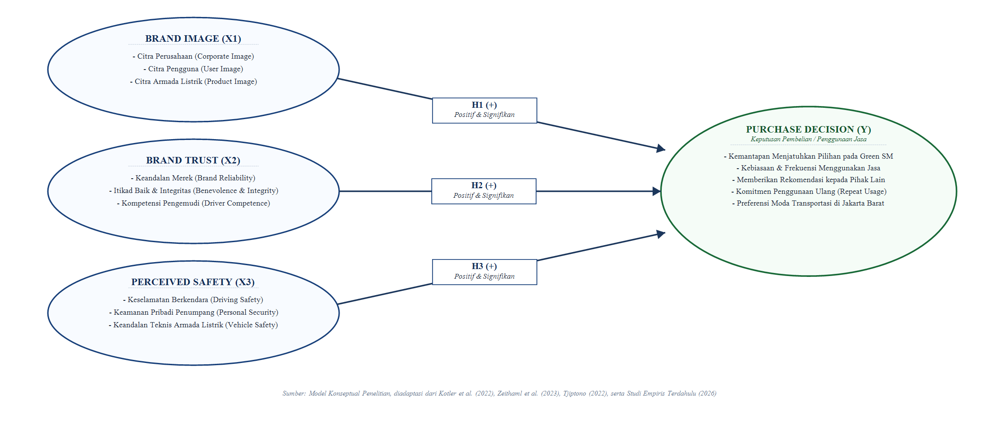

# BAB II
# TINJAUAN PUSTAKA DAN PENGEMBANGAN HIPOTESIS

## 2.1 Landasan Teori

### 2.1.1 Perilaku Konsumen dan Keputusan Pembelian (*Purchase Decision*)
Secara fundamental, ilmu pemasaran memandang bahwa keberhasilan suatu entitas bisnis dalam mempertahankan kelangsungan hidupnya ditentukan oleh pemahaman mendalam terhadap perilaku konsumen (*consumer behavior*). Menurut Kotler et al. (2022), perilaku konsumen adalah studi tentang bagaimana individu, kelompok, dan organisasi memilih, membeli, menggunakan, dan memanfaatkan barang, jasa, ide, atau pengalaman untuk memuaskan kebutuhan dan keinginan mereka. 

Lebih lanjut, Schiffman dan Wisenblit (2024) mendefinisikan keputusan pembelian (*purchase decision*) sebagai proses kognitif penyeleksian salah satu tindakan dari dua atau lebih pilihan alternatif yang tersedia di pasar. Dalam pandangan ini, keputusan pembelian hanya terjadi apabila konsumen dihadapkan pada kumpulan pilihan alternatif (*choice of alternatives*). Apabila konsumen tidak memiliki alternatif lain, maka tindakan tersebut bukanlah sebuah proses pengambilan keputusan yang bebas. Dalam konteks mobilitas perkotaan di Jakarta Barat, kehadiran taksi *Green SM* menjadi alternatif baru yang bersaing langsung dengan pemain lama (*Blue Bird, GrabCar, GoCar*), sehingga keputusan konsumen untuk memesan dan membayar layanan *Green SM* merefleksikan hasil penyeleksian sadar atas moda transportasi yang dinilai paling mampu memuaskan kebutuhan perjalanannya.

Dalam model hirarki pengambilan keputusan konsumen klasik yang dikembangkan oleh Engel, Blackwell, dan Miniard (model EBM) serta dirumuskan kembali oleh Kotler et al. (2022), proses pengambilan keputusan konsumen melewati lima tahapan berurutan (*five-stage model of the consumer buying process*):
1. **Pengenalan Kebutuhan (*Problem Recognition*):** Proses pembelian bermula ketika konsumen menyadari adanya masalah atau kebutuhan yang dipicu oleh stimulus internal (seperti kebutuhan mendesak untuk bertransportasi dari Jakarta Barat ke pusat perkantoran) maupun stimulus eksternal (seperti promosi visual armada taksi listrik *Green SM* di jalanan).
2. **Pencarian Informasi (*Information Search*):** Konsumen yang terdorong kebutuhannya akan mencari informasi melalui sumber pribadi (rekomendasi teman/keluarga), sumber komersial (iklan digital, aplikasi *Green SM*), sumber publik (ulasan media massa, media sosial), dan sumber pengalaman langsung.
3. **Evaluasi Alternatif (*Evaluation of Alternatives*):** Konsumen memproses informasi mengenai merek-merek yang bersaing (*Green SM*, *Blue Bird*, *GrabCar*, *GoCar*) dengan mengevaluasi atribut fungsional, citra merek (*brand image*), persepsi keamanan (*perceived safety*), dan tarif perjalanan.
4. **Keputusan Pembelian (*Purchase Decision*):** Pada tahap evaluasi, konsumen membentuk preferensi antar-merek dalam kumpulan pilihan dan membentuk niat untuk membeli merek yang paling disukai. Dalam konteks jasa transportasi, keputusan pembelian diwujudkan dalam tindakan nyata (*actual behavior*) mengunduh aplikasi, memesan, dan membayar tarif perjalanan taksi *Green SM*.
5. **Perilaku Pasca-Pembelian (*Post-Purchase Behavior*):** Setelah menggunakan jasa taksi *Green SM*, konsumen akan membandingkan ekspektasi awal dengan kinerja aktual layanan yang diterimanya, menghasilkan kepuasan (*satisfaction*) atau ketidakpuasan (*dissatisfaction*), yang selanjutnya bermuara pada keputusan penggunaan ulang (*repeat purchase/usage*) atau penyebaran rekomendasi positif dari mulut ke mulut (*word-of-mouth*).

Menurut Kotler et al. (2022) serta Tjiptono (2022), indikator baku untuk mengukur Keputusan Pembelian (*Purchase Decision*) dalam sektor jasa meliputi:
1. **Kemantapan pada sebuah produk/jasa:** Tingkat keyakinan dan kemantapan konsumen dalam menjatuhkan pilihan pada taksi *Green SM* dibandingkan moda transportasi lain.
2. **Kebiasaan dalam membeli/menggunakan jasa:** Tingkat frekuensi atau kontinuitas konsumen dalam menjadikan taksi *Green SM* sebagai preferensi utama mobilitas hariannya di Jakarta Barat.
3. **Memberikan rekomendasi kepada orang lain:** Kesediaan konsumen untuk menyarankan, mengajak, atau membagikan pengalaman positif menggunakan taksi *Green SM* kepada rekan, relasi, dan keluarga.
4. **Melakukan penggunaan kembali (*repeat usage*):** Komitmen konsumen untuk terus menggunakan jasa taksi *Green SM* di masa yang akan datang.

---

### 2.1.2 Citra Merek (*Brand Image*)
Menurut Kotler, Keller, dan Chernev (2022) serta Aaker (2023), citra merek (*brand image*) adalah persepsi tentang suatu merek sebagaimana tercermin oleh sekumpulan asosiasi merek yang tersimpan dalam ingatan kognitif konsumen (*brand associations held in consumer memory*). Asosiasi merek merupakan simpul-simpul informasi yang terhubung dengan simpul merek dalam memori konsumen dan mengandung makna merek bagi konsumen. Citra merek yang kokoh dan positif memberikan keunggulan kompetitif bagi perusahaan karena mampu menyederhanakan pemrosesan informasi bagi konsumen, membedakan produk/jasa dari pesaing, membangkitkan alasan rasional untuk membeli, serta menciptakan asosiasi emosional yang menguntungkan.

Dalam perspektif manajemen pemasaran jasa modern, Lovelock, Wirtz, dan Chew (2022) mendefinisikan citra merek (*brand image*) sebagai kesan mental menyeluruh dan reputasi perseptual yang tersimpan dalam pikiran pelanggan mengenai kapabilitas organisasi, nilai-nilai inti, serta kepribadian layanan yang membedakannya secara distingtif dari para pesaing di pasar. Dalam bisnis transportasi, citra merek tidak hanya dibentuk oleh identitas visual armada, melainkan juga oleh pengalaman interaksi langsung penumpang dengan kualitas pelayanan pengemudi dan keandalan armada. Bagi *Green SM*, *brand image* menjadi sarana diferensiasi utama untuk menonjolkan identitasnya sebagai pelopor armada taksi 100% mobil listrik (*pure EV*) yang ramah lingkungan (*zero emission*) dan berteknologi tinggi di Jakarta Barat.

Berdasarkan sintesis Kotler, Keller, dan Chernev (2022), Aaker (2023), serta Lovelock et al. (2022), dimensi dan indikator baku *Brand Image* dalam penelitian ini terdiri atas:
1. **Citra Perusahaan (*Corporate Image*):** Persepsi konsumen terhadap reputasi, kredibilitas, profesionalisme, dan skala operasional korporasi penyedia jasa (PT Xanh SM / *Vingroup*) di mata masyarakat Jakarta Barat.
2. **Citra Pengguna (*User Image*):** Persepsi tentang kepribadian, gaya hidup, dan status sosial pengguna taksi *Green SM*, yaitu sebagai masyarakat modern yang cerdas, peduli terhadap isu lingkungan hidup (*eco-friendly*), dan melek teknologi (*tech-savvy*).
3. **Citra Produk/Armada (*Product Image*):** Persepsi mengenai karakteristik fisik dan kualitas atribut armada mobil listrik *VinFast VF 5* yang dioperasikan *Green SM*, meliputi tampilan warna hijau toska yang elegan, kebersihan armada, keheningan kabin tanpa polusi suara mesin (*zero noise*), serta teknologi canggih di dalam kabin.

---

### 2.1.3 Kepercayaan Merek (*Brand Trust*)
Kotler, Keller, dan Chernev (2022) serta Adha dan Suhardi (2025) mendefinisikan *Brand Trust* sebagai kesediaan konsumen untuk mempercayai dan mengandalkan kemampuan suatu merek dalam menjalankan fungsi yang telah dinyatakannya secara konsisten (*willingness to rely on the ability of the brand to perform its stated function*). Kepercayaan merupakan variabel relasional yang sangat berharga dalam konteks industri jasa transportasi, di mana konsumen menyerahkan keselamatan fisik dan ketepatan waktu perjalanannya kepada operator penyedia jasa.

Sejalan dengan hal tersebut, Priansa (2021) serta Lovelock dan Wirtz (2022) menegaskan bahwa kepercayaan merek (*brand trust*) dalam sektor jasa adalah keyakinan dan kemauan konsumen untuk memercayakan risiko kepada penyedia jasa berdasarkan ekspektasi positif bahwa perusahaan memiliki integritas, kompetensi teknis, dan konsistensi dalam memberikan layanan terbaik sesuai dengan janji yang dipublikasikannya (*delivering on its promises*). Mengingat jasa transportasi merupakan produk yang tidak berwujud (*intangible*) dan memiliki risiko keselamatan fisik, *Brand Trust* berfungsi sebagai peredam ketidakpastian (*uncertainty reducer*) yang memantapkan keyakinan calon penumpang bahwa taksi *Green SM* akan mengantarkan mereka ke tempat tujuan dengan aman, nyaman, dan dengan tarif yang transparan.

Dalam literatur pemasaran relasional mutakhir (Kotler et al., 2022; Hera & Fourqoniah, 2023; Fadila & Wahyuni, 2025), konstruk *brand trust* dibangun melalui dua dimensi utama:
1. **Keandalan Merek (*Brand Reliability*):** Keyakinan kognitif konsumen bahwa merek mampu dan kompeten dalam memenuhi janji layanannya secara konsisten. Dalam konteks taksi *Green SM*, keandalan ini tecermin dari ketepatan waktu penjemputan armada, ketersediaan unit di sekitar wilayah Jakarta Barat, stabilitas aplikasi pemesanan digital, dan kepastian argo tarif yang adil dan transparan.
2. **Itikad Baik / Integritas Merek (*Brand Intentions / Benevolence*):** Keyakinan emosional konsumen bahwa perusahaan memiliki itikad baik untuk mengutamakan kepentingan, kenyamanan, dan keselamatan konsumen di atas sekadar mengejar profitabilitas jangka pendek. Hal ini diwujudkan dalam keramahan dan kejujuran mitra pengemudi *Green SM*, respon cepat layanan pelanggan (*customer care*), serta jaminan ganti rugi apabila terjadi kendala operasional.

Dimensi dan indikator baku *Brand Trust* dalam penelitian ini diadaptasi dari Kotler et al. (2022), Hera dan Fourqoniah (2023), serta Adha dan Suhardi (2025):
1. Keyakinan bahwa taksi *Green SM* selalu memenuhi janji layanannya (*brand reliability*).
2. Keyakinan bahwa tarif taksi *Green SM* transparan, jujur, dan tidak merugikan konsumen (*financial integrity*).
3. Keyakinan atas kompetensi dan profesionalisme pengemudi *Green SM* dalam melayani perjalanan (*driver competence*).
4. Rasa percaya bahwa *Green SM* peduli terhadap kenyamanan dan kesejahteraan penumpangnya (*brand benevolence*).

---

### 2.1.4 Persepsi Keamanan dan Keselamatan (*Perceived Safety*)
Dalam industri transportasi penumpang, keselamatan merupakan kebutuhan paling mendasar (*core benefit*) yang tidak dapat dikompromikan. Zeithaml, Bitner, dan Gremler (2023) serta Tjiptono (2022) menempatkan dimensi keamanan (*security*) sebagai komponen vital dalam evaluasi mutu jasa, yang mencakup kebebasan dari bahaya, risiko fisik, atau keraguan (*freedom from danger, risk, or doubt*).

Tjiptono (2022) serta Lovelock dan Wirtz (2022) merumuskan bahwa persepsi keamanan dan keselamatan (*Perceived Safety*) adalah tingkat keyakinan subjektif pelanggan bahwa seluruh proses penghantaran jasa (*service delivery process*) terbebas dari bahaya fisik (*physical harm*), risiko kecelakaan lalu lintas, ancaman kerugian finansial, kegagalan teknis peralatan jasa, maupun keraguan psikologis selama konsumen berinteraksi dengan penyedia jasa.

Dalam konteks transportasi darat modern, *Perceived Safety* didefinisikan sebagai penilaian subjektif penumpang mengenai sejauh mana perjalanan bersama suatu moda transportasi terlindungi dari ancaman fisik, kecelakaan lalu lintas, tindak kriminalitas, serta kegagalan teknis armada (Wijaya & Pahar, 2022; Adha & Suhardi, 2025). Khusus untuk armada taksi listrik murni (*pure electric vehicle* / *EV*), persepsi keselamatan penumpang memiliki karakteristik unik yang mencakup evaluasi terhadap keandalan teknologi baterai dan sistem keselamatan elektrik kendaraan.

Berdasarkan kerangka Zeithaml et al. (2023), Tjiptono (2022), Lovelock dan Wirtz (2022), Wijaya dan Pahar (2022), serta Adha dan Suhardi (2025), dimensi dan indikator *Perceived Safety* dalam penelitian ini mencakup:
1. **Keselamatan Berkendara (*Driving & Physical Safety*):** Persepsi penumpang bahwa pengemudi *Green SM* mengemudikan kendaraan secara tertib, mematuhi batas kecepatan dan rambu lalu lintas, serta tidak ugal-ugalan di jalanan Jakarta Barat.
2. **Keamanan Pribadi (*Personal Security*):** Persepsi penumpang bahwa mereka merasa aman dari risiko pelecehan, pencurian, atau tindak kriminalitas selama berada di dalam kabin taksi *Green SM*, didukung oleh identitas pengemudi yang terverifikasi resmi dan fitur pelacak rute GPS pada aplikasi.
3. **Keandalan Teknis Armada Listrik (*Vehicle Technical Safety*):** Keyakinan penumpang terhadap kelayakan fisik dan teknis mobil listrik *VinFast VF 5* yang digunakan *Green SM*, termasuk keandalan pengereman (*regenerative braking*), sistem suspensi, serta keamanan baterai listrik dari risiko korsleting atau kebakaran, terutama saat melintasi jalanan basah atau cuaca hujan di Jakarta Barat.

---

## 2.2 Penelitian Terdahulu
Berikut disajikan tabel sintesis 10 artikel jurnal ilmiah empiris terdahulu yang seluruhnya memiliki struktur model regresi multi-variabel (3X & 1Y), menguji variabel terikat yang sama yaitu *Purchase Decision* (Keputusan Pembelian), serta mengandung setidaknya 2 variabel bebas yang sama dengan penelitian ini:

**Tabel 2.1 Sintesis Penelitian Terdahulu**

| No | Peneliti & Tahun | Judul Penelitian | Variabel Diteliti (Struktur 3X & 1Y) | Sampel & Metode | Temuan Pokok Penelitian |
|---|---|---|---|---|---|
| 1 | Wijaya & Pahar (2022) | *Pengaruh Citra Merek, Kepercayaan Merek, dan Keamanan Privasi Terhadap Keputusan Pengguna Gojek* | $X_1$: Citra Merek ($X_1$); $X_2$: Kepercayaan Merek ($X_2$); $X_3$: Keamanan Privasi ($X_3$); $Y$: Keputusan Pengguna Jasa Transportasi ($Y$) | 100 responden transportasi online; Regresi Linear Berganda | Citra Merek, Kepercayaan Merek, dan Keamanan secara simultan dan parsial berpengaruh positif dan signifikan terhadap keputusan penggunaan layanan transportasi publik. |
| 2 | Asnawir & Simanjuntak (2024) | *The Role of Perceived Risk in Moderating the Effects of Brand Image, E-WOM, and Brand Trust on Purchase Decision in Shopee Mall* | $X_1$: *Brand Image* ($X_1$); $X_2$: *Brand Trust* ($X_2$); $X_3$: *Perceived Risk* ($X_3$); $Y$: *Purchase Decision* ($Y$) | 120 responden konsumen; *PLS-SEM* / Moderated Regression | *Brand Image* dan *Brand Trust* berpengaruh positif signifikan terhadap *Purchase Decision*, sedangkan *Perceived Risk* memitigasi keraguan konsumen dalam bertransaksi. |
| 3 | Nurlita & Arsyad (2025) | *Pengaruh Brand Awareness, Brand Image, dan Brand Trust Terhadap Keputusan Pembelian* | $X_1$: *Brand Awareness*; $X_2$: *Brand Image* ($X_1$); $X_3$: *Brand Trust* ($X_2$); $Y$: Keputusan Pembelian ($Y$) | 115 responden; Regresi Linear Berganda | *Brand Image* dan *Brand Trust* secara simultan dan parsial berpengaruh positif dan signifikan terhadap keputusan pembelian konsumen ($p < 0,05$). |
| 4 | Hera & Fourqoniah (2023) | *Pengaruh Brand Image dan Brand Ambassador Terhadap Purchase Decision melalui Brand Trust sebagai Intervening* | $X_1$: *Brand Image* ($X_1$); $X_2$: *Brand Ambassador*; $X_3$: *Brand Trust* ($X_2$); $Y$: *Purchase Decision* ($Y$) | 100 responden; Analisis Jalur (*Path Analysis*) | *Brand Image* dan *Brand Trust* berpengaruh positif dan signifikan terhadap pemantapan *Purchase Decision* konsumen. |
| 5 | Adha & Suhardi (2025) | *The Role of Influencers, Brand Image, Ease of Use, and Consumer Trust in Electric Vehicle Purchase Decisions* | $X_1$: *Influencer*; $X_2$: *Brand Image* ($X_1$); $X_3$: *Ease of Use*; $X_4$: *Consumer Trust* ($X_2$); $Y$: *Purchase Decision EV* ($Y$) | 130 responden Jabodetabek; Regresi Linear Berganda | *Brand Image* dan *Consumer Trust* berpengaruh positif dan signifikan terhadap keputusan pembelian armada kendaraan listrik (*EV*). |
| 6 | Patria & Susila (2023) | *Pengaruh Kualitas Pelayanan, E-Wom Dan Brand Image Terhadap Keputusan Pembelian Konsumen Dimediasi Oleh Brand Trust* | $X_1$: Kualitas Pelayanan; $X_2$: *Brand Image* ($X_1$); $X_3$: *Brand Trust* ($X_2$); $Y$: Keputusan Pembelian ($Y$) | 100 responden; Analisis Jalur & Regresi Berganda | *Brand Image* dan *Brand Trust* secara simultan dan parsial berpengaruh positif dan signifikan terhadap keputusan pembelian konsumen. |
| 7 | Putri & Harti (2022) | *Pengaruh Brand Image dan Brand Ambassador Terhadap Keputusan Pembelian Melalui Kepercayaan Konsumen* | $X_1$: *Brand Image* ($X_1$); $X_2$: *Brand Ambassador*; $X_3$: Kepercayaan Konsumen ($X_2$); $Y$: Keputusan Pembelian ($Y$) | 110 responden; Analisis Jalur (*Path Analysis*) | *Brand Image* dan Kepercayaan Konsumen secara langsung meningkatkan keputusan pembelian konsumen secara signifikan. |
| 8 | Vivi & Hikmah (2024) | *Pengaruh Kualitas Produk, Persepsi Keamanan dan Kepercayaan Terhadap Keputusan Pembelian* | $X_1$: Kualitas Produk; $X_2$: Persepsi Keamanan ($X_3$); $X_3$: Kepercayaan ($X_2$); $Y$: Keputusan Pembelian ($Y$) | 100 responden; Regresi Linear Berganda | Persepsi Keamanan (*Perceived Safety*) dan Kepercayaan (*Trust*) secara simultan dan parsial berpengaruh positif dan signifikan terhadap Keputusan Pembelian. |
| 9 | Wulandari (2021) | *Pengaruh Kepercayaan, Keamanan, Persepsi Resiko dan Kualitas Pelayanan Terhadap Keputusan Pembelian Secara Online* | $X_1$: Kepercayaan ($X_2$); $X_2$: Keamanan ($X_3$); $X_3$: Persepsi Resiko; $X_4$: Kualitas Pelayanan; $Y$: Keputusan Pembelian ($Y$) | 100 responden; Regresi Linear Berganda | Jaminan Keamanan dan Kepercayaan terbukti menjadi faktor determinan utama yang secara signifikan menentukan keputusan pembelian konsumen. |
| 10 | Patricia & Djong (2026) | *Keputusan Penggunaan QRIS Berdasarkan Pengaruh Persepsi Kemudahan dan Keamanan Melalui Persepsi Kepercayaan Pada GEN_Z* | $X_1$: Persepsi Kemudahan; $X_2$: Persepsi Keamanan ($X_3$); $X_3$: Kepercayaan ($X_2$); $Y$: Keputusan Penggunaan/Transaksi ($Y$) | 100 responden *Gen-Z*; Regresi Linear Berganda | Persepsi Keamanan (*Perceived Safety*) dan Kepercayaan (*Brand Trust*) secara langsung meningkatkan keputusan penggunaan secara signifikan. |

---

## 2.3 Pengembangan Hipotesis Penelitian

### 2.3.1 Pengaruh *Brand Image* terhadap *Purchase Decision*
Citra merek (*Brand Image*) merupakan representasi kognitif dan emosional dari keseluruhan pengalaman dan asosiasi konsumen terhadap suatu merek (Kotler et al., 2022; Aaker, 2023). Ketika suatu merek memiliki citra yang positif, prestisius, dan relevan dengan nilai-nilai konsumen (seperti kepedulian terhadap kelestarian lingkungan dan modernitas armada listrik), risiko yang dirasakan konsumen dalam melakukan transaksi akan menurun, sementara keyakinan terhadap nilai produk/jasa akan meningkat.

Pada operasional taksi *Green SM* di wilayah Jakarta Barat, citra merek sebagai pelopor taksi listrik murni dengan standar pelayanan premium dan armada hening tanpa emisi memberikan diferensiasi kuat yang menarik minat masyarakat perkotaan. Bukti empiris dari Wijaya dan Pahar (2022) pada industri transportasi membuktikan bahwa citra merek secara signifikan memicu keputusan konsumen. Temuan ini diperkuat oleh Nurlita dan Arsyad (2025), Asnawir dan Simanjuntak (2024), Patria dan Susila (2023), Devananda dan Hartono (2023), Fadila dan Wahyuni (2025), Inggasari dan Prabowo (2022), serta Adha dan Suhardi (2025) pada adopsi kendaraan listrik yang secara konsisten mengonfirmasi bahwa *Brand Image* berpengaruh positif dan signifikan terhadap *Purchase Decision*. Berdasarkan landasan teoritis dan empiris tersebut, maka hipotesis pertama dirumuskan sebagai berikut:

> **$H_1$:** *Brand Image* berpengaruh positif dan signifikan terhadap *Purchase Decision* dalam penggunaan jasa taksi *Green SM* di wilayah Jakarta Barat.

---

### 2.3.2 Pengaruh *Brand Trust* terhadap *Purchase Decision*
Kepercayaan merek (*Brand Trust*) merupakan pondasi utama dalam hubungan jangka panjang antara penyedia jasa dan pelanggan (Kotler et al., 2022; Hera & Fourqoniah, 2023; Adha & Suhardi, 2025). Dalam industri jasa taksi, kepercayaan mencakup kepastian bahwa taksi akan menjemput tepat waktu (*reliability*), rute yang dilalui efisien, argo tarif dihitung secara transparan tanpa manipulasi (*integrity*), dan pengemudi bertindak jujur serta profesional (*competence*).

Ketiadaan rasa percaya akan menimbulkan keengganan konsumen untuk mencoba layanan baru. Sebaliknya, tingkat kepercayaan merek yang tinggi akan menghilangkan keraguan konsumen, sehingga secara langsung mempercepat peralihan dari sekadar evaluasi alternatif menjadi tindakan pembelian nyata (*actual purchase decision*). Studi empiris oleh Hera dan Fourqoniah (2023), Nurlita dan Arsyad (2025), Adha dan Suhardi (2025), Putri dan Harti (2022), Devananda dan Hartono (2023), Fadila dan Wahyuni (2025), Inggasari dan Prabowo (2022), Afendi dan Suhardi (2026), Agustiningrum dan Widyastuti (2021), Ardialis dan Irfani (2023), Dahlia dan Hartono (2024), serta Wijaya dan Pahar (2022) secara konsisten mengonfirmasi bahwa *Brand Trust* memiliki pengaruh positif dan signifikan terhadap keputusan pembelian konsumen. Oleh karena itu, hipotesis kedua dirumuskan sebagai berikut:

> **$H_2$:** *Brand Trust* berpengaruh positif dan signifikan terhadap *Purchase Decision* dalam penggunaan jasa taksi *Green SM* di wilayah Jakarta Barat.

---

### 2.3.3 Pengaruh *Perceived Safety* terhadap *Purchase Decision*
Keselamatan dan keamanan penumpang merupakan kebutuhan mutlak (*hygiene factor*) dalam industri transportasi perkotaan (Zeithaml *et al.*, 2023; Tjiptono, 2022). Teori persepsi risiko konsumen (Kotler et al., 2022; Asnawir & Simanjuntak, 2024) menggarisbawahi bahwa konsumen akan menghindari pilihan yang dipersepsikan memiliki risiko keselamatan tinggi. Sebaliknya, persepsi keamanan (*Perceived Safety*) yang tinggi—yang mencakup keyakinan bahwa pengemudi berkendara secara aman dan hati-hati (*driving safety*), terlindung dari risiko tindak kejahatan di dalam kabin (*personal security*), serta keandalan teknis baterai mobil listrik *VinFast* saat beroperasi di tengah lalu lintas padat maupun cuaca hujan Jakarta Barat (*vehicle technical safety*)—akan menciptakan rasa tenang (*peace of mind*).

Penelitian Wijaya dan Pahar (2022) pada moda transportasi penumpang, Afendi dan Suhardi (2026) pada layanan transportasi dan pemesanan daring, Vivi dan Hikmah (2024), Wulandari (2021), Asnawir dan Simanjuntak (2024), Devananda dan Hartono (2023), Agustiningrum dan Widyastuti (2021), Ardialis dan Irfani (2023), Dahlia dan Hartono (2024), serta Patricia dan Djong (2026) membuktikan bahwa persepsi keamanan berpengaruh positif dan signifikan terhadap keputusan penggunaan dan pembelian layanan. Hal ini juga selaras dengan hasil studi Dosen FEB UKRIDA, Melitina Tecoalu (2021), yang menegaskan pentingnya jaminan keselamatan dan keandalan operasional armada dalam mendorong keputusan penggunaan layanan transportasi di Jakarta. Semakin tinggi persepsi keselamatan yang dirasakan konsumen terhadap armada *Green SM*, semakin mantap keputusan mereka untuk menggunakan jasa taksi tersebut. Oleh karena itu, hipotesis ketiga dirumuskan sebagai berikut:

> **$H_3$:** *Perceived Safety* berpengaruh positif dan signifikan terhadap *Purchase Decision* dalam penggunaan jasa taksi *Green SM* di wilayah Jakarta Barat.

---

## 2.4 Kerangka Pemikiran Konseptual

Berdasarkan tinjauan landasan teori dan perumusan hipotesis penelitian, penelitian ini berfokus pada pengujian pengaruh parsial dari ketiga variabel eksogen (*Brand Image*, *Brand Trust*, dan *Perceived Safety*) terhadap variabel endogen (*Purchase Decision*). Sesuai dengan arahan dosen pembimbing, pengujian hipotesis difokuskan secara mendalam pada pembuktian kausalitas masing-masing variabel independen terhadap variabel dependen ($H_1, H_2, \text{dan } H_3$ melalui Uji statistik t) serta evaluasi kemampuan variasi model melalui koefisien determinasi ($R^2$).

Hubungan struktural antara variabel independen (*Brand Image*, *Brand Trust*, *Perceived Safety*) dan variabel dependen (*Purchase Decision*) digambarkan dalam kerangka pemikiran konseptual berikut:

**Gambar 2.1 Kerangka Pemikiran Konseptual Penelitian**

